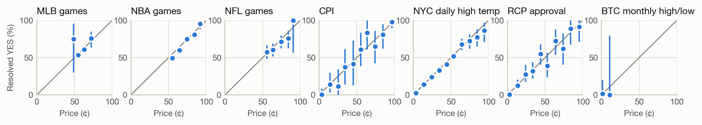

# Are Kalshi prices calibrated? Five categories, 24 hours before close

Damian Abrol · Kelley School of Business, Indiana University · October 2026
{: .byline}

**Bottom line.** Across 12,732 settled markets in sports, economics, weather, politics and crypto, Kalshi prices 24 hours before close track outcomes closely: in 44 of 46 ten-cent price bins, the average price falls inside the 95% interval of the share that resolved YES. The two exceptions shrink under scrutiny: NBA favorites' gap is mostly the overround, and high-priced NYC temperature contracts' gap disappears once stale prices are removed.

Each point is a 10¢ price bin (x = average price, y = share resolved YES) with its 95% interval; gray line = perfect calibration. Sports panels show each game's favorite.
{: .caption}

| Group | Analyzed | Avg price | Resolved YES (95% CI) | Gap (pts) | Brier (reference) |
|---|---|---:|---:|---:|---:|
| MLB games | favorite side of 2,529 games | 57.0¢ | 55.9% (54.0–57.8%) | −1.1 | 0.2441 (0.2465) |
| NBA games | favorite side of 1,498 games | 69.4¢ | 66.4% (63.9–68.7%) | −3.0 | 0.2058 (0.2233) |
| NFL games | favorite side of 387 games | 67.2¢ | 65.1% (60.2–69.7%) | −2.1 | 0.2189 (0.2271) |
| CPI | 423 markets in 64 events | 50.7¢ | 50.1% (38.2–62.0%) | −0.6 | 0.0787 (0.2500) |
| NYC daily high temp | 6,748 markets in 1,778 events | 23.9¢ | 22.7% (20.8–24.7%) | −1.2 | 0.1387 (0.1756) |
| RCP approval | 1,019 markets in 211 events | 18.8¢ | 17.7% (13.1–23.4%) | −1.2 | 0.0869 (0.1454) |
| BTC monthly high/low | 128 markets in 18 events | 1.4¢ | 1.6% (0.0–20.1%) | +0.2 | 0.0146 (0.0154) |

**Method.** Kalshi public API, eight series, markets settled 2021 to October 2026. Price = last trade at or before 24h before close; markets with under 1,000 contracts of lifetime volume excluded. Two-team sports use each game's favorite only, because the two sides are mirror bets; NFL preseason games are excluded. Other series use every market, with intervals from resampling whole events, because markets within an event are linked. Reference Brier = always predicting the group's overall YES rate.

### Findings
1. **Sports favorites' gaps are mostly the overround.** MLB, NBA and NFL favorites won slightly less often than priced (−1.1, −3.0, −2.1 points), but a game's two sides summed to 100.74¢, 101.78¢ and 101.04¢ on average. Net of that, favorites' prices (56.6¢, 68.2¢, 66.5¢) are each inside their interval. NBA favorites priced 50–69¢ still sit below the line, even after removing stale prices (−6.4 and −4.6 points), so that range is worth a closer look.
2. **The largest gap is a stale-price effect.** NYC temperature contracts at 80¢ or more resolved YES 7.9 points less often than priced (88.5¢ vs 80.6%). Dropping prices that were more than 3h stale or outside the bid-ask flips the 80–89¢ and 90–99¢ bins from −7.6 and −8.2 to +1.8 and +2.0.
3. **Longshots ran slightly rich, but not significantly.** Contracts under 20¢ resolved YES less often than priced in CPI (5.9¢ vs 3.8%), NYC temperature (7.2¢ vs 6.5%) and RCP approval (5.1¢ vs 3.2%). The direction is consistent, but every interval contains the price.

### Limitations
- One horizon (24h). MLB markets closing in 2025 opened a median of 14h before close, so the MLB sample is mostly the 2026 season.
- Crypto is thin: the typical Kalshi BTC market lives about an hour. The monthly high/low series give 128 markets in 18 events, all priced under 20¢.
- Prices are last trades, which include the bid-ask spread but not fees. Brier scores reflect how settled outcomes are a day out, so they don't rank categories.
- NFL is small (387 games, 2025 season and 2026 to date); its preseason games are excluded, NBA's are not.
- With 46 bins at 95% confidence, about two misses are expected by chance alone.
