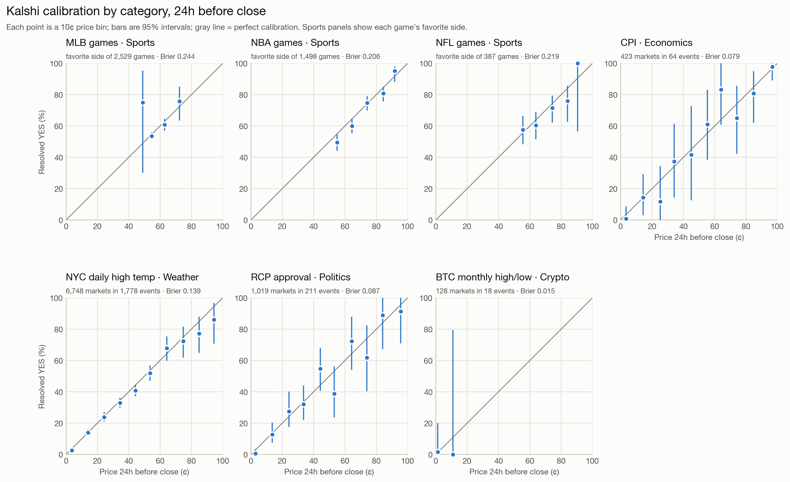

# Are Kalshi prices calibrated? Five categories, 24 hours before close

Damian Abrol · Kelley School of Business, Indiana University · October 2026
{: .byline}

## Summary

**Question.** When a Kalshi contract trades at X¢ a day before close, does it resolve YES about X% of the time, across categories and across price ranges?

**Bottom line.** Yes, closely. Across 12,732 settled markets in 6,485 events, the average price falls inside the 95% interval of the share that resolved YES in 44 of 46 ten-cent price bins. Overall gaps between price and outcome range from −3.0 to +0.2 points by category. The two exceptions shrink under scrutiny:

- **Sports favorites' gaps are mostly the overround.** In MLB, NBA and NFL, favorites won a little less often than priced (−1.1, −3.0 and −2.1 points), but the two sides of a game summed to more than $1 on average. Net of that, every sport's favorite price is inside its interval; for NBA, the largest gap, it is 68.2¢ against a 66.4% win rate (95% CI 63.9–68.7%). NBA favorites at 50–69¢ still sit below the line after robustness checks, so that range deserves a closer look.
- **High-priced NYC temperature contracts' gap is a stale-price effect.** At 80¢ or more they resolved YES 7.9 points less often than priced, but excluding stale or out-of-spread prices flips the 80–89¢ and 90–99¢ bins to +1.8 and +2.0.
- **Longshots ran slightly rich, but not significantly.** Under 20¢, YES came in below the price in CPI, NYC temperature and RCP approval (−2.1, −0.7 and −1.9 points), but every interval contains the price.

## Data

Settled markets from Kalshi's public API (archived and live endpoints) with hourly price history. Series were chosen by screening candidates on market metadata (number of events, volume, and how long markets stay open; see `results/series_screening.md`): the one per category with the most usable history at a 24h horizon, plus a second sport. NFL was added later; its markets start in 2025, so it covers one full season (the Super Bowl isn't in this series) and 2026 to date.

| Group | Series | Event structure | Analyzed | Markets closing |
|---|---|---|---|---|
| MLB games | KXMLBGAME | two teams, one wins | 2,529 games (favorite side) | Apr 2025 – Oct 2026 |
| NBA games | KXNBAGAME | two teams, one wins | 1,498 games (favorite side) | Apr 2025 – Oct 2026 |
| NFL games | KXNFLGAME | two teams, one wins | 387 games (favorite side) | Sep 2025 – Oct 2026 |
| CPI | KXCPI | "CPI above X" thresholds | 423 markets, 64 events | Jul 2021 – Oct 2026 |
| NYC daily high temp | KXHIGHNY | ~6 ranges, one wins | 6,748 markets, 1,778 events | Aug 2021 – Oct 2026 |
| RCP approval | KXAPRPOTUS | ~9 ranges, one wins | 1,019 markets, 211 events | Oct 2021 – Oct 2026 |
| BTC monthly high/low | KXBTCMAXMON, KXBTCMINMON | "BTC reaches / falls to X" | 128 markets, 18 events | Jan – Oct 2026 |

Crypto is the weak spot. Kalshi's daily Bitcoin series are dominated by hourly markets (median lifespan 1h; only 2% open at least 24h before close), so the only usable crypto series are the monthly high and low (93 and 86 settled markets, 10 events each), pooled here.

## Method

**Price.** The last traded price at or before 24 hours before close, from hourly candles. Only candles that end at or before the snapshot are used, so no later trade leaks in. Hours without trades carry the last trade forward; a market with no trade by then is dropped. Final prices are not used because they converge to $0 or $1 at settlement.

**When "close" is.** Each event's markets normally close together at a time that doesn't depend on the outcome. The BTC monthly markets are different: each closes the moment Bitcoin touches its level, which always means YES, so a market's own close time reveals its outcome. For those, the snapshot is anchored to Kalshi's scheduled end for the month, and markets that had already resolved by then are dropped (23 of 93 and 21 of 86).

**Which markets count.** In two-team sports the two markets are mirror bets, so each game is counted once, from the favorite's side. NFL preseason games (186 markets) are excluded because starters often sit; NBA's October preseason games were not separated out and remain in its sample. An early version that picked a random side produced what looked like across-the-board overpricing; it was noise from the random draw, since a randomly chosen team must win half the time. In the other series every market is used, and intervals come from an event bootstrap: whole events are resampled 2,000 times, because markets within an event are linked (exactly one range wins; thresholds are nested). Each bootstrap interval is floored at a Wilson interval that counts each event once, because the bootstrap understates uncertainty when YES results in a bin are rare.

**Filters and measures.** Binary markets settled YES or NO (tied NFL games settle at 50¢ and are left out), with at least 1,000 contracts of lifetime volume (this keeps 99.7% of MLB games). Prices are grouped in 10¢ bins; each bin compares the average price with the share that resolved YES, with a 95% interval (Wilson for sports). The Brier score is reported next to a reference: always predicting the group's overall YES rate.

## Results

{: style="width: 80%; margin: 0 auto;"}

| Group | Avg price | Resolved YES (95% CI) | Gap (pts) | Brier | Reference | Bins with avg price inside CI |
|---|---:|---:|---:|---:|---:|---:|
| MLB games | 57.0¢ | 55.9% (54.0–57.8%) | −1.1 | 0.2441 | 0.2465 | 4 of 4 |
| NBA games | 69.4¢ | 66.4% (63.9–68.7%) | −3.0 | 0.2058 | 0.2233 | 3 of 5 |
| NFL games | 67.2¢ | 65.1% (60.2–69.7%) | −2.1 | 0.2189 | 0.2271 | 5 of 5 |
| CPI | 50.7¢ | 50.1% (38.2–62.0%) | −0.6 | 0.0787 | 0.2500 | 10 of 10 |
| NYC daily high temp | 23.9¢ | 22.7% (20.8–24.7%) | −1.2 | 0.1387 | 0.1756 | 10 of 10 |
| RCP approval | 18.8¢ | 17.7% (13.1–23.4%) | −1.2 | 0.0869 | 0.1454 | 10 of 10 |
| BTC monthly high/low | 1.4¢ | 1.6% (0.0–20.1%) | +0.2 | 0.0146 | 0.0154 | 2 of 2 |

The two bins outside their intervals are both NBA (50–59¢ and 60–69¢). Brier scores mostly reflect how settled each category's outcomes already are a day out (many CPI thresholds are near-certain by then), so they show that prices beat the no-information reference everywhere but don't rank categories.

### Longshots and heavy favorites

| Group | Band | Markets | Avg price | Resolved YES | 95% CI | Gap (pts) |
|---|---|---:|---:|---:|---:|---:|
| NBA games | 80¢ and up | 342 | 86.2¢ | 84.2% | 80.0–87.7% | −2.0 |
| NFL games | 80¢ and up | 55 | 84.7¢ | 78.2% | 65.6–87.1% | −6.6 |
| CPI | under 20¢ | 160 | 5.9¢ | 3.8% | 1.1–12.5% | −2.1 |
| CPI | 80¢ and up | 162 | 94.8¢ | 95.1% | 86.3–98.4% | +0.3 |
| NYC daily high temp | under 20¢ | 3,315 | 7.2¢ | 6.5% | 5.4–8.0% | −0.7 |
| NYC daily high temp | 80¢ and up | 93 | 88.5¢ | 80.6% | 71.4–88.4% | −7.9 |
| RCP approval | under 20¢ | 692 | 5.1¢ | 3.2% | 1.4–6.9% | −1.9 |
| RCP approval | 80¢ and up | 41 | 90.5¢ | 90.2% | 75.6–97.7% | −0.3 |
| BTC monthly high/low | under 20¢ | 128 | 1.4¢ | 1.6% | 0.0–20.1% | +0.2 |

For two-team sports only the favorite side is analyzed, so a favorite at 85¢ is the same bet as its opponent at 15¢. NFL's heavy-favorite gap rests on 55 games; its interval contains the price.

**The overround in sports.** Either side of a game can be bought, and the two prices add up to more than $1 on average: 100.74¢ in MLB, 101.78¢ in NBA and 101.04¢ in NFL. Part of any favorite's gap is that extra. Dividing the favorite's price by the sum of both sides gives 56.6¢, 68.2¢ and 66.5¢, against win rates of 55.9%, 66.4% and 65.1%; all three are inside their intervals.

## Robustness: stale and out-of-spread prices

Each series was re-run without markets whose last trade was over 3 hours old at the snapshot or outside the bid-ask.

- **MLB, NBA and NFL:** results barely move (105, 88 and 2 markets removed; Brier 0.2441 to 0.2439, 0.2058 to 0.2049 and 0.2189 to 0.2180). NBA's 50–59¢ and 60–69¢ gaps persist (−6.4 and −4.6).
- **NYC temperature:** 1,950 markets removed; Brier improves from 0.1387 to 0.1335, and the 80–99¢ shortfall disappears. Low-priced bins are unchanged (0–9¢: −0.9 either way).
- **CPI and RCP approval:** these markets trade too rarely for this check to be informative; it removes 370 of 423 CPI markets and 390 of 1,019 approval markets.

## Limitations

- **One horizon.** Everything is measured 24 hours before close. MLB markets closing in 2025 opened a median of 14h before close (75h in 2026), so 4,254 MLB markets (45.5%) had no 24h price and the MLB sample is mostly the 2026 season.
- **Last-trade prices** include the bid-ask spread and exclude Kalshi's fees, so they are not exactly the probabilities traders expected.
- **Choosing the favorite** by the higher of two slightly noisy prices tilts its price up a little, which can make favorites look marginally overpriced.
- **One series per category** (three in sports, two in crypto). The results may not hold for other series in the same category.
- **NFL is small** (387 games), and its preseason games are excluded while NBA's are included.
- **Many bins.** With 46 bins at 95% confidence, about two misses are expected by chance alone.

## What I would test next

- Other horizons (1 hour, 1 week) to see how calibration changes as close approaches.
- The bid-ask midpoint instead of the last trade, and the overround across all ranges of a temperature or approval event.
- NBA favorites at 50–69¢ with the overround removed bin by bin, the one range where a gap survives.
- More series per category (other cities' temperatures, payrolls, Fed decisions) to test whether these patterns generalize.
